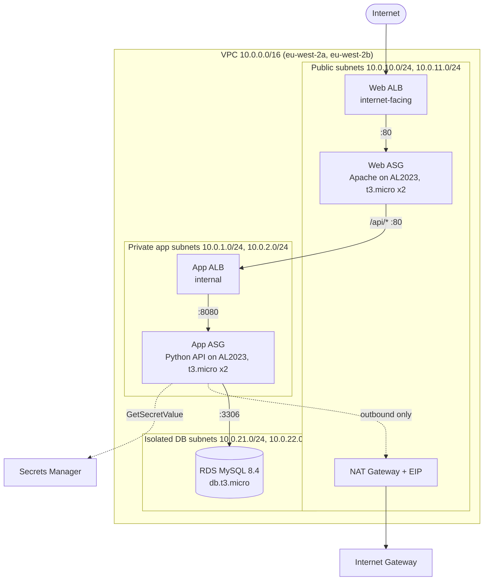

# Three-Tier Architecture on AWS with Terraform

A web, app and database tier deployed across two availability zones in `eu-west-2`, built with reusable Terraform modules. Each tier only accepts traffic from the tier directly in front of it, there is no SSH anywhere, and the database password never appears in code or state outputs.



## What gets built

| Tier | Resources |
|---|---|
| Network | VPC, 2 public, 2 private app and 2 isolated DB subnets, Internet Gateway, NAT Gateway with Elastic IP, public / app / DB route tables, locked-down default security group, VPC flow logs to CloudWatch |
| Presentation | Internet-facing ALB, target group with health checks, Auto Scaling group of Apache servers that proxy `/api/*` to the app tier |
| Logic | Internal ALB, Auto Scaling group running a small Python API that reads and writes to MySQL |
| Data | RDS MySQL 8.4 in a DB subnet group spanning both AZs, encrypted storage, password generated and held in Secrets Manager |
| Access | IAM instance roles with SSM Session Manager, IMDSv2 enforced, encrypted gp3 root volumes |

## Where this differs from the brief, and why

| Brief says | Built | Reason |
|---|---|---|
| Two web EC2s, MySQL on an EC2, logic tier described but never built | Web ASG, app ASG behind an internal ALB, RDS | Matches the architecture diagram. The text version is effectively two tiers. |
| One private subnet for the database | Two DB subnets | RDS requires a DB subnet group covering at least two AZs. |
| Amazon Linux 2 | Amazon Linux 2023 | Amazon Linux 2 reached end of support in 2026. AMI ID comes from the AWS public SSM parameter, so it is never hard-coded. |
| t2.micro | t3.micro | Current generation, cheaper per unit of performance. |
| SSH on 22 from trusted IPs, then SSH through a public instance into the private one | No port 22, no key pairs, SSM Session Manager into any instance | Removes the biggest attack surface on the web tier. Access is IAM-controlled and logged in CloudTrail. Validation steps still prove the same things (see below). |
| Database SG allows 3306 from web servers | 3306 from app servers only | In a three-tier design the web tier never talks to the database. |
| `terraform apply` after each step | Modules, plus `-target` commands to apply step by step | The final code still applies cleanly from empty in one run. |

Known lab trade-offs: the ALB listens on HTTP only (no domain or ACM certificate), RDS is single-AZ, one NAT Gateway is shared by both AZs. Each is one variable or one listener away from production settings.

## Security scanning

Every push runs `terraform fmt`, `terraform validate`, `tflint` and `checkov`. **Checkov fails the build on any new finding.** Current result: 204 passed, 0 failed, 35 skipped.

Findings were handled in one of three ways:

| Approach | Examples |
|---|---|
| **Fixed** | VPC flow logs, RDS IAM authentication, RDS error and slow query logs, AZs pinned by name, KMS encryption and multipart cleanup on the state bucket |
| **Accepted for the lab, with a reason** | HTTPS (needs a domain), ALB and RDS deletion protection (would block `destroy`), Multi-AZ RDS (cost), WAF and ALB access logs (cost and scope), short log retention |
| **False positives** | Security groups "not attached" (they are, in other modules), port 80 "open to the world" on rules whose source is a security group |

Each skip sits next to the resource it applies to as `#checkov:skip=ID:reason`, so the reasoning is reviewed with the code and nothing is hidden in a global ignore list:

```bash
grep -rn "checkov:skip" --include=*.tf .
```

## Repo layout

```
.
├── bootstrap/                  # one-off: S3 bucket for remote state
├── modules/
│   ├── network/                # vpc.tf, internet_gateway.tf, nat_gateway.tf, route_tables.tf
│   ├── security/               # all five security groups and their rules
│   ├── alb/                    # reused for the public web ALB and internal app ALB
│   ├── compute/                # reused for web and app: IAM, launch template, ASG, scaling
│   └── database/               # DB subnet group and RDS MySQL
├── templates/                  # user data for each tier
├── main.tf  variables.tf  outputs.tf  providers.tf  versions.tf  backend.tf
└── .github/workflows/terraform-ci.yml   # fmt, validate, tflint, checkov on every push
```

## Prerequisites

- Terraform 1.10 or newer
- AWS CLI v2 configured for the target account
- Session Manager plugin for the AWS CLI (`brew install --cask session-manager-plugin` on macOS)

## Deploy

**1. Create the state bucket (once)**

```bash
cd bootstrap
terraform init
terraform apply
cd ..
```

**2. Point the main stack at it**

```bash
cp backend.hcl.example backend.hcl
# set bucket to the state_bucket_name output from step 1
terraform init -backend-config=backend.hcl
```

To skip remote state, delete `backend.tf` and run a plain `terraform init`.

**3. Apply**

All at once:

```bash
terraform plan -out=tfplan
terraform apply tfplan
```

Or step by step, matching the assignment and taking a console screenshot after each:

```bash
terraform apply -target=module.network     # Steps 1 to 3: VPC, subnets, IGW, NAT, route tables
terraform apply -target=module.security    # Step 5: security groups
terraform apply -target=module.database    # Data tier (takes 5 to 10 minutes)
terraform apply                            # Steps 4 and 6: ALBs, target groups, both ASGs
```

Full build takes around 15 minutes, mostly RDS. Instances need another 2 to 3 minutes after that to pass health checks.

## Validate

**Step 8: load balancing**

```bash
open "$(terraform output -raw web_url)"
```

The page shows which web server served it, which app server answered, and a live row count from MySQL. Refresh and the instance IDs change. From the terminal:

```bash
URL=$(terraform output -raw web_url)
for i in $(seq 1 20); do curl -s "$URL" | grep -o 'i-[0-9a-f]\{17\}' | head -1; done | sort | uniq -c
```

You should see roughly half the requests on each web server.

**Step 7: internet access per tier**

List the instances:

```bash
aws ec2 describe-instances --region eu-west-2 \
  --filters "Name=tag:Project,Values=three-tier" "Name=instance-state-name,Values=running" \
  --query "Reservations[].Instances[].[Tags[?Key=='Tier']|[0].Value,InstanceId,PrivateIpAddress,PublicIpAddress]" \
  --output table
```

App instances show `None` for public IP. That alone shows they cannot be reached from the internet.

Web server, direct internet access through the IGW:

```bash
aws ssm start-session --target <web-instance-id>
curl -s https://checkip.amazonaws.com    # prints the instance's own public IP
```

App server, outbound only through the NAT Gateway:

```bash
aws ssm start-session --target <app-instance-id>
curl -s https://checkip.amazonaws.com    # prints the NAT Elastic IP, not its own
curl -s localhost:8080/db                # proves app to RDS connectivity
```

Compare the second result with `terraform output nat_public_ips`. Matching IPs prove the private instance reaches the internet only via NAT.

Route tables, as written evidence:

```bash
aws ec2 describe-route-tables --region eu-west-2 \
  --filters "Name=vpc-id,Values=$(terraform output -raw vpc_id)" \
  --query "RouteTables[].[Tags[?Key=='Name']|[0].Value,Routes[?DestinationCidrBlock=='0.0.0.0/0']|[0].[GatewayId,NatGatewayId]]" \
  --output json
```

Public routes to `igw-...`, app routes to `nat-...`, DB has no default route at all.

## Cost

Rough eu-west-2 on-demand pricing while everything is running: NAT Gateway, two ALBs, four t3.micro, one db.t3.micro and five public IPv4 addresses come to about **$0.20 an hour, roughly $5 a day**, plus data transfer. Apply, validate, screenshot, destroy in the same sitting.

## Destroy

```bash
terraform destroy
```

Then check the Billing dashboard and EC2 > Elastic IPs for anything left over. The state bucket in `bootstrap/` has `prevent_destroy` and costs pennies; leave it.

## Troubleshooting

- **Targets unhealthy:** `aws ssm start-session` into the instance and read `/var/log/user-data.log`. For the app tier also check `journalctl -u app`.
- **Suspect a security group is blocking traffic:** search the flow logs for rejected packets: `aws logs filter-log-events --log-group-name "$(terraform output -raw flow_log_group)" --filter-pattern REJECT --max-items 20`
- **Page loads but app or DB shows "unreachable":** the app tier is still booting, or RDS is still creating. Wait two minutes and refresh.
- **`start-session` fails:** the instance needs a minute after boot to register with SSM, and the Session Manager plugin must be installed locally.
